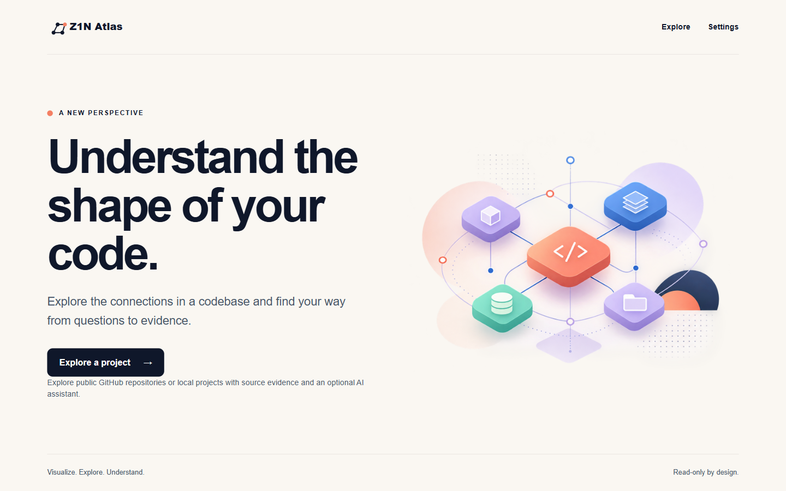
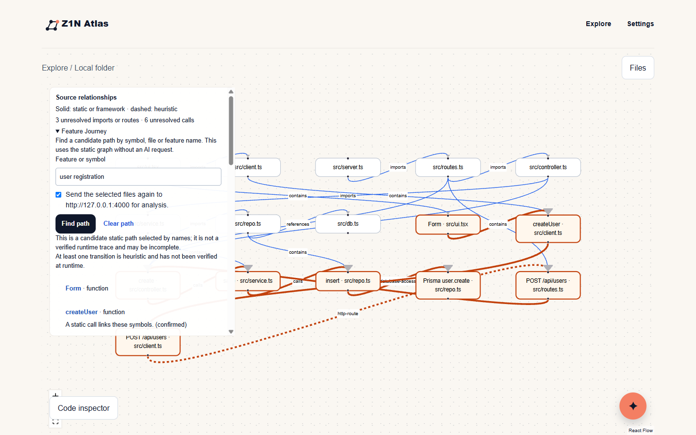

# Z1N Atlas

**Visualize. Explore. Understand.**

Z1N Atlas is a read-only application for exploring source code through a relationship graph and evidence. Import a public GitHub repository or choose a local folder to index its source paths, open any indexed file, and analyze a bounded selection of supported TypeScript/JavaScript and Python relationships.

The analyzer resolves imports, re-exports, root TypeScript path aliases, selected symbols and static calls. It also identifies supported React event attributes, rendered components, Next.js page entries, literal `fetch` requests, requests through functions that forward their arguments to `fetch` with parameterized template-literal addresses, axios requests, Express and Fastify routes with statically mounted routers including inline handlers, static Next.js App Router endpoints, Pages Router API routes, Python modules, imports, calls and classes, FastAPI routes with composed router prefixes, SQLAlchemy models and session operations, literal requests/httpx client calls, and selected Prisma Client operations. Client requests are matched against analyzed routes by path pattern and method, including across JavaScript and Python files. Framework conventions require a React import or supported project manifest; Next.js conventions require an imported package manifest declaring Next.js. HTTP matches are **heuristic**; static relations are not runtime traces. Dynamic addresses that name no analyzed route, configuration inheritance, external packages, many framework patterns, other database libraries and runtime behavior are not fully resolved. Requests, routes and handlers that could not be resolved are reported at their source location. Settings can discover models from OpenAI, Google Gemini and Anthropic. The assistant answers individual questions with bounded evidence and clickable citations. Feature Journey comes in two modes: with a configured provider, the model explores the analyzed code through controlled read-only tools and proposes a path whose every step is validated against the graph; without a provider, or on request, a static mode ranks candidate paths by feature or symbol names — a deterministic fallback, not AI understanding. Either mode may select the wrong candidate or miss paths, and live provider verification of the journey loop has not been performed.

## Architecture

- `apps/web`: Next.js frontend, file selection, inspector and graph.
- `apps/api`: Fastify HTTP service for public GitHub import and isolated analysis.
- `packages/contracts`: shared Zod HTTP schemas and evidence validation.
- `packages/analysis-core`: TypeScript/JavaScript analysis using ts-morph and the TypeScript compiler, and Python analysis using the tree-sitter Python grammar compiled to WebAssembly.

Analysis runs as a cancellable Node worker job with progress stages, a 45-second backstop timeout, a 1 GB V8 old-generation heap limit and a 16 MB graph result limit; the application does not execute or modify imported source. Job records and reusable results are held in backend memory for at most five minutes; at most two cached graphs of up to 16 MB each are retained. They contain graph evidence snippets, but not the complete submitted file list or provider keys. Worker heap limits do not cap total process memory or replace deployment-level resource limits.

## Run locally

Use Node.js 22.12 or newer and pnpm 11.

```sh
pnpm install --frozen-lockfile
pnpm dev
```

Open http://localhost:3000. The API listens on `127.0.0.1:4000` by default. `pnpm dev` builds shared packages before starting both processes. For production-style local execution:

```sh
pnpm build
pnpm --filter @z1n/api start
# In another terminal:
pnpm --filter @z1n/web start
```

To use a different backend, set `NEXT_PUBLIC_API_URL` in `apps/web/.env.local` before building or starting the web app. It must be an HTTPS origin, except HTTP is permitted for localhost. Configure `WEB_ORIGIN` on the API to the exact frontend origin; `HOST` and `PORT` control its listener. The API defaults to loopback and must not be exposed publicly without deployment-level authentication, distributed rate limiting and resource controls. Environment examples are in `.env.example`.

## Privacy and limits

Local selection is read in the browser. Before analysis the app displays the configured backend address and asks for explicit consent to send selected local files; a remote backend receives their contents. Browser selection does not grant the server filesystem access. The server processes the submitted contents in memory, without running project code. The selection is discarded on reload or tab closure.

Provider keys are held in browser memory for the current tab and sent to the configured backend when requesting a model list or testing a model, then forwarded to the selected provider. They are not persisted by the application. Model discovery does not verify generation access, and listings may be incomplete. The optional test sends a short generation request that may incur provider charges. Provider integration is tested with mocks; live credentials have not been used to verify it.

For each assistant request, the app sends the selected files to the configured backend and bounded relevant excerpts to the selected AI provider after consent. The backend reuses an unexpired matching analysis when available, and otherwise analyzes the selection again. Providers may retain submitted data according to their own policies. Only citations found in the analyzed selection are accepted, but a valid citation does not guarantee that the model's explanation is correct. The assistant can miss relevant evidence and is not a runtime trace. Requests may incur provider charges.

Feature Journey sends the selection to the configured backend again with consent. In AI-guided mode it also sends the question and, per tool call, bounded excerpts to the configured provider over a bounded number of rounds; this may incur charges. The model can search code, read lines, follow verified relationships and list routes; it never edits anything, and the identifiers it cites are accepted only if the analyzed graph contains them, with connecting edges taken from the graph itself. In static mode nothing leaves the backend: candidate paths are ranked by symbol and file names. Every displayed transition comes from the static graph; heuristic matches and missing boundaries are identified as uncertain. Neither mode understands the complete application.

Analysis is limited to 2,000 files, 256 KB per file and 10 MB total. The bounds were measured on real repositories: the analysis worker needs close to a hundred times the source size in memory, so the byte total is what protects memory. When a repository exceeds the bounds, both importers keep every package manifest first, then application code spread across directories — JavaScript, TypeScript and Python alike — and only then tests, stories, mocks, generated files, ambient declarations, Python test files and database migrations. Documents, styles and other files that are not scripts are considered last, because they add a node but no relationships. Independently of the analysis bounds, an import indexes up to 20,000 eligible paths of at most 1 MB each. GitHub import inventories the recursive tree and downloads the selected files 16 at a time within a 60-second deadline. Local folder selection walks the chosen folder in the browser and stops with an incomplete index beyond 100,000 entries, 20 directory levels or the 20,000-path bound. The other indexed files remain inspectable: local files are read in the browser, and GitHub files are fetched through the backend at the pinned commit, limited to 60 requests per minute and four concurrent requests per process. Coverage is partial whenever files are skipped or the index is incomplete, and the import summary and Files panel report both. Common secrets, generated directories and unsupported file types are excluded by path, but filters cannot detect every secret in source content. Review your selection before sharing. GitHub and raw-content rate limits may prevent imports. Per-process request limits are not a distributed rate limiter.

## Checks

```sh
pnpm lint
pnpm typecheck
pnpm test
pnpm format:check
pnpm build
pnpm exec playwright install chromium
pnpm test:e2e
```

The browser smoke test starts both applications, analyzes a synthetic local project through the real API, and mocks AI-provider responses. Stop any existing servers on ports 3000 and 4000 before running it.

## Try it

1. Start both applications, choose **Explore**, and import the public [Z1N Atlas repository](https://github.com/zakaria1n/z1n-atlas).
2. Open the workspace and analyze the selected files. The importer reports skipped files and whether the index is complete, so the resulting map is a partial view when files were left out. Open the Files panel to browse every indexed path; folders start collapsed, and a filter narrows the list.
3. Choose a file or relationship to inspect its source. Switch **Graph scope** to include symbols, or enter a name under **Feature Journey** to focus on a candidate static path. Switch back to the full graph for context.
4. Optionally select a provider and model in Settings to ask an evidence-linked question. Read the sharing notice before sending source excerpts to a provider.

The screenshots show the running application. The journey example uses a synthetic React/Express/Prisma test project.




## Dependencies and attribution

The graph uses [React Flow](https://reactflow.dev/) and the inspector uses [Prism React Renderer](https://github.com/FormidableLabs/prism-react-renderer). The analysis engine uses [ts-morph](https://github.com/dsherret/ts-morph) and, for Python, [web-tree-sitter](https://github.com/tree-sitter/py-tree-sitter) with the MIT-licensed tree-sitter-python grammar from [tree-sitter-wasms](https://github.com/Gregoor/tree-sitter-wasms). Their licenses and those of transitive packages are distributed with the dependencies; `pnpm licenses list --prod` lists the installed production licenses. Platform-specific image-processing binaries may include LGPL-licensed components; review their included notices when redistributing binaries.
